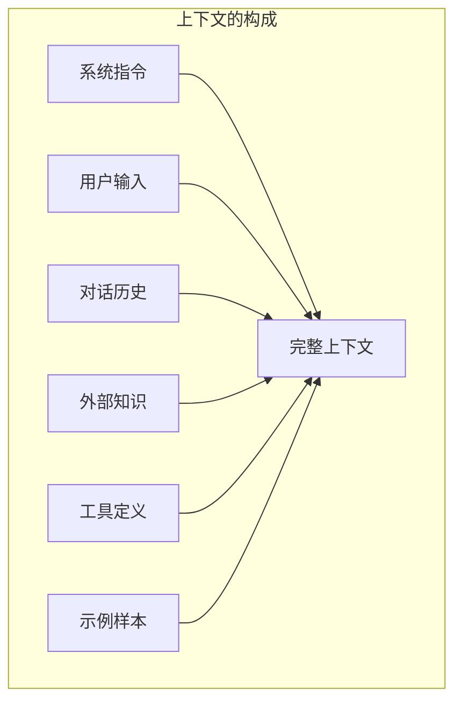

## 1.1 什么是上下文工程

### 1.1.1 定义与内涵

**上下文工程**（Context Engineering）是一门系统性的工程学科，它研究如何设计、组织、优化和管理大语言模型所需的全部信息环境，以确保模型能够在正确的时间获得正确的信息，从而产生准确、可靠、符合预期的输出。

这个定义包含几个关键要素：

1. **系统性**：上下文工程是一套完整的方法论体系，而非孤立的技巧集合
2. **信息环境**：关注所有可能影响模型行为的信息，而不限于输入给模型的文本
3. **时机与形式**：强调在正确的时间、以正确的格式提供信息
4. **目标导向**：最终目的是实现可靠、可预测的模型输出

### 1.1.2 上下文的多维构成

在大模型应用中，“上下文”是一个多层次的概念，它包括：

图 1-1：上下文的多维构成

- **系统指令**：定义模型角色、行为准则和输出格式的基础设定
- **用户输入**：当前任务的具体请求和参数
- **对话历史**：多轮对话中的历史交互记录
- **外部知识**：通过检索或其他方式引入的领域知识、事实信息
- **工具定义**：模型可调用的外部工具、API 的描述
- **示例样本**：用于引导模型行为的少样本示例

### 1.1.3 上下文工程的核心挑战

上下文工程面临三大核心挑战：

第一，上下文窗口有限。现代大模型的上下文窗口已扩展到数十万甚至百万 Token，但仍是有限资源；待处理信息超出窗口容量时，必须从中选出最相关的内容。

第二，信息质量与密度。模型的输出质量高度依赖输入信息的质量，冗余、噪声或不相关的信息既浪费上下文空间，也可能干扰模型的判断。在不少评测与线上实践中，过度填充上下文（Context Stuffing）常会带来性能波动、成本上升和延迟增加。

第三，动态与实时性。许多应用需要实时更新的信息，如最新的市场数据、用户状态或系统配置；构建动态的上下文管理系统、确保信息的时效性，是一项持续的技术挑战。

### 1.1.4 与驭具工程的关系

业界提出的**驭具工程（Harness Engineering）** 涵盖让智能体在生产环境中可靠运行的全部工程实践，包括工具与权限编排、上下文动态管理、反馈纠错闭环、安全守卫四大职能。上下文工程是其中“上下文动态管理”这一核心支柱，负责决定在什么时间节点、把哪些记忆和背景信息注入模型的上下文窗口。

上下文工程关注“模型看到什么”，驭具工程关注“模型如何安全可靠地执行”。两者互为补充：上下文管理再精准，缺少权限控制、错误恢复和安全守卫，智能体仍无法在真实业务中稳定运行。

### 1.1.5 上下文工程的重要性

上下文工程的重要性体现在四个方面。它放大模型能力：同一个模型配合精心设计的上下文，可以展现出截然不同的能力水平。它保障可靠性：系统化的上下文管理能显著降低幻觉、错误和不一致行为。它决定成本效率：上下文策略直接影响 Token 使用量和 API 调用成本。它是可扩展性的基础：复杂 AI 应用要建立在良好的上下文架构之上。

随着大模型从问答助手演进为能完成复杂任务的智能体，上下文工程的重要性还将提升。在智能体中，上下文是动态演化的工作空间，而不只是静态输入。

这一判断已在政策层面得到体现。2026 年 7 月印发的[《北京市加快智能体引领发展若干措施》](../appendix/references.md)把智能体底层共性技术攻关列为重点，明确支持创新主体实施驾驭层工程（Harness Engineering，即本书 1.1.4 节所称“驭具工程”，同指一门学科），并把“上下文工程优化”置于夯实智能体共性底座的诸项共性技术之首。上下文工程由此从一线团队的经验技巧，成为写入地方发展政策的基础性技术优先项。
