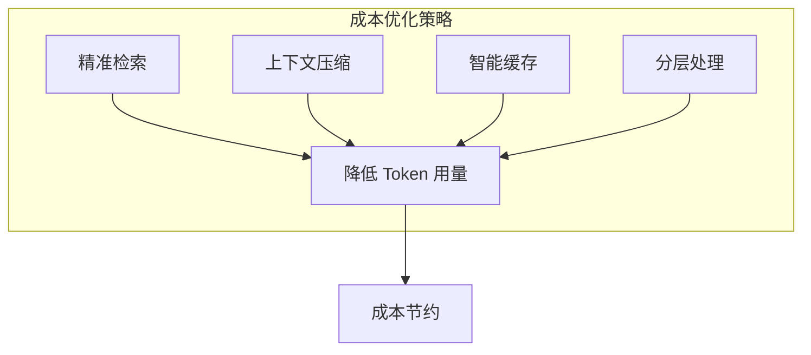

## 1.3 上下文工程的核心价值

上下文工程的价值从技术层面延伸到商业层面，最终影响用户体验和产品成败。

### 1.3.1 提升模型输出质量

上下文工程的首要价值是提升模型输出质量，体现在准确性、相关性和一致性三个方面。

准确性方面，精准的知识检索和上下文构建为模型提供执行任务所需的事实依据，大幅降低幻觉和错误的发生概率。在一些公开研究与工程实践中，引入高质量上下文的 [RAG](../05_select/5.1_rag_principles.md) 流程常能带来显著的事实一致性改进，但提升幅度会受到任务类型、检索质量、重排序与评测口径等因素影响。

相关性方面，动态上下文管理让模型获得与当前任务高度相关的信息，避免被无关内容干扰；相关性是决定用户满意度的关键因素之一。一致性方面，系统化的上下文策略能保证模型在不同会话、不同用户、不同时间点行为一致，企业级应用尤其需要这一点。

### 1.3.2 优化成本效率

在大模型应用中，Token 使用量直接关联成本。上下文工程通过四类策略优化成本：

图 1-3：成本优化策略

- **精准检索**：只检索和传递必需的信息，避免上下文冗余
- **上下文压缩**：通过摘要等技术压缩信息，保留关键内容
- **智能缓存**：复用频繁使用的上下文片段，减少重复计算
- **分层处理**：对不同复杂度的任务使用不同规模的模型或策略

在一些高并发、重复上下文比例较高的场景中，结合精准检索、压缩与缓存，往往可以观察到明显的 Token 消耗下降；实际节约比例取决于请求分布、缓存命中率、上下文组织方式与模型定价。

### 1.3.3 增强系统可靠性

生产环境对可靠性有严格要求。上下文工程在以下维度增强系统可靠性：

| 可靠性维度 | 上下文工程的作用 |
|------------|------------------|
| 错误预防 | 通过上下文约束降低模型产生不当输出的概率 |
| 边界控制 | 明确定义模型的能力边界和行为约束 |
| 故障隔离 | 模块化的上下文设计便于定位和隔离问题 |
| 降级策略 | 当部分上下文源不可用时提供优雅降级 |
| 可审计性 | 完整的上下文记录支持事后分析和审计 |

### 1.3.4 支撑复杂应用场景

上下文工程使以下复杂 AI 应用成为可能：

- **多轮对话系统**：通过对话历史管理和上下文累积，支持具有“记忆”的多轮对话。
- **智能体系统**：为智能体提供工作记忆、长期记忆和工具访问能力，使其能执行跨越多个步骤的复杂任务。
- **多模态应用**：统一管理文本、图像、代码等不同模态的上下文信息，支持多模态理解和生成。
- **垂直领域应用**：集成专业知识库并采用领域特定的上下文策略，构建面向特定领域的 AI 解决方案。

### 1.3.5 加速开发迭代

上下文工程的工程化方法从四个方面提升开发效率：

- **模块化设计**：将上下文管理分解为可复用的模块（检索器、压缩器、记忆管理器等），便于组合和替换。
- **可测试性**：上下文构建过程可测试、可度量，支持自动化测试和持续优化。
- **可观测性**：完善的上下文日志和监控，便于理解系统行为、诊断问题、迭代改进。
- **团队协作**：标准化的上下文工程实践便于团队协作，降低知识壁垒。

### 1.3.6 创造竞争优势

从商业角度看，上下文工程能力是 AI 应用的核心竞争力之一。在相同的基础模型上，出色的上下文工程可以带来差异化的用户体验；积累的上下文策略、领域知识库和优化经验形成技术壁垒；上下文工程框架支持系统持续学习和改进，灵活的上下文管理也让系统能快速适应新需求、新场景。

AI 能力逐渐商品化后，上下文工程能力将成为区分产品优劣的关键因素：能精准理解用户需求、高效利用模型能力、提供可靠一致体验的产品，将在竞争中胜出。
