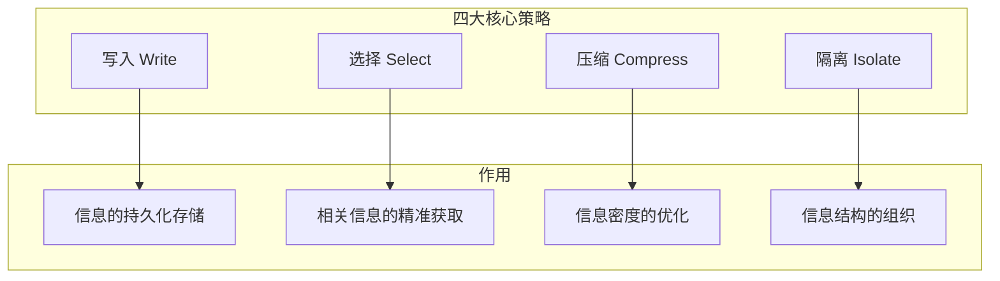

## 3.2 四大核心策略概览

上下文工程的实践可以归纳为四大核心策略：**写入**（Write）、**选择**（Select）、**压缩**（Compress）、**隔离**（Isolate）。这四大策略相互配合，共同构成上下文管理的完整方法论。

### 3.2.1 策略框架总览

图 3-3：四大核心策略总览

### 3.2.2 写入策略

写入策略回答的问题是：如何在上下文窗口之外存储和管理信息。上下文窗口是有限的，许多应用却需要处理远超窗口容量的信息，写入策略解决的就是信息的持久化存储。

主要技术包括：
- 外部记忆系统：将信息存储到外部存储中供后续检索
- 知识库构建：组织结构化的领域知识
- 向量数据库：将文本转换为向量进行存储和检索
- 记忆架构：设计多层次的记忆结构

典型应用场景包括构建企业知识库、实现跨会话的长期记忆、存储用户偏好和历史。详细技术见[第四章](../04_write/README.md)。

### 3.2.3 选择策略

选择策略回答的问题是：如何从海量信息中获取与当前任务最相关的内容。信息存储在外部时，需要在执行任务时选择性地加载相关内容。选择策略是 [RAG](../05_select/5.1_rag_principles.md)（[检索增强生成](../05_select/5.1_rag_principles.md)）的核心。

主要技术包括：
- 语义检索：基于语义相似度搜索相关内容
- 关键词检索：基于关键词匹配的精确搜索
- 混合检索：结合语义和关键词的优势
- 重排序：对检索结果进行二次排序优化

典型应用场景包括文档问答系统、知识库查询和代码检索。详细技术见[第五章](../05_select/README.md)。

### 3.2.4 压缩策略

压缩策略回答的问题是：如何在有限的上下文空间中容纳更多有效信息。经过筛选后，需要放入上下文的信息仍可能超出限制，或占用过多空间导致成本上升，压缩策略的目标是提高信息密度。

主要技术包括：
- 文本摘要：将长文档压缩为精练摘要
- 信息提取：提取关键事实和实体
- 对话压缩：压缩冗长的对话历史
- 递进式摘要：分层次逐步压缩

典型应用场景包括长文档处理、对话历史管理和成本优化。详细技术见[第六章](../06_compress/README.md)。

### 3.2.5 隔离策略

隔离策略回答的问题是：如何组织和结构化上下文中的不同信息。信息经过精选和压缩后，其组织方式同样重要，隔离策略关注的是上下文的结构化设计。

主要技术包括：
- XML/标签标记：用标签区分不同类型内容
- 指令分层：分层组织系统指令
- 任务隔离：为不同任务创建独立上下文
- 多智能体编排：在多智能体间分配上下文

典型应用场景包括复杂提示词设计、多任务系统和智能体协作。详细技术见[第七章](../07_isolate/README.md)。

### 3.2.6 策略之间的关系

四大策略构成一个协作的工作流：

图 3-4：策略协作工作流

1. **写入**：将信息存储到外部系统
2. **选择**：检索相关信息
3. **压缩**：优化信息密度
4. **隔离**：结构化组织

实际应用中，这些策略可能需要迭代执行：检索后发现信息不足，触发新的写入；压缩后发现关键信息丢失，调整压缩策略；隔离过程中发现结构不合理，重新组织。

同时要警惕 **边界泄漏**：写入层存储的外部内容、选择层召回的文档、压缩层生成的摘要都可能混入看似“指令”的文本。进入隔离层前应保留来源、权限、时间戳和可信等级；进入最终上下文后，也要明确把外部内容标记为“数据”而不是“系统指令”。否则四种策略会在边界处相互污染，导致提示注入、旧事实覆盖新事实或跨用户数据串扰。

### 3.2.7 策略选择指南

不同场景对策略的侧重不同：

| 场景 | 重点策略 | 原因 |
|------|----------|------|
| 知识密集型问答 | 选择 | 准确检索是关键 |
| 长期助手 | 写入 | 需要持久记忆 |
| 成本敏感应用 | 压缩 | 控制 Token 用量 |
| 复杂指令系统 | 隔离 | 清晰的结构很重要 |

大多数生产级应用需要综合运用四种策略，并按具体场景确定侧重。
