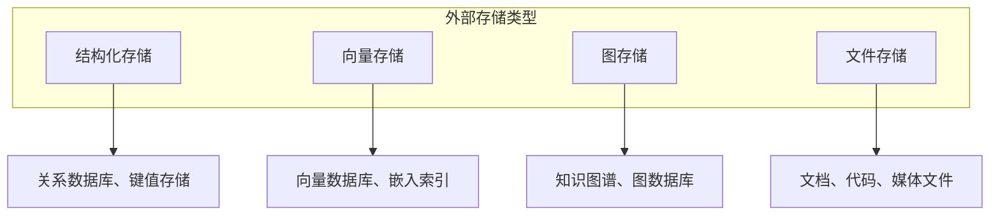
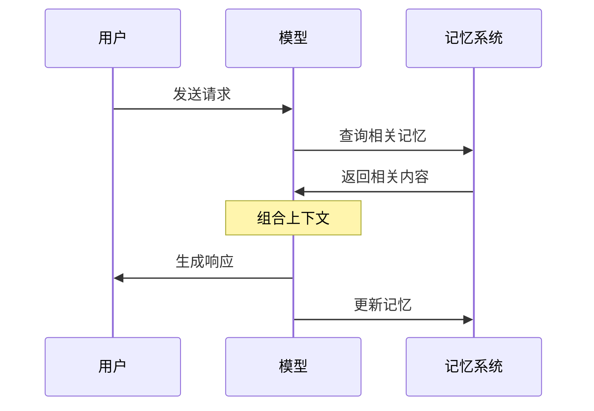

## 4.1 外部存储与记忆系统

### 4.1.1 为什么需要外部存储

大语言模型本身没有持久记忆能力，每次交互都从零开始，只能依赖当前上下文中的信息。这带来三个问题：

1. **会话隔离**：不同会话之间无法共享信息
2. **容量限制**：大量信息无法同时放入上下文窗口
3. **时效性**：模型训练数据有截止日期，缺乏最新知识

外部存储系统让模型能够“记住”超出上下文窗口的信息，并在需要时检索使用。

大语言模型的外部存储设计可以借鉴人脑的记忆形成机制。人脑处理信息的闭环是 **“刺激 → 筛选 → 巩固 → 遗忘 → 再学习”**：

1. **刺激与筛选**：并非所有感官信息都会留下痕迹。对应到大模型应用，需要在“写入”阶段进行选择性过滤，只提取对当前场景有价值的信息（降低冗余）。
2. **短期与激活记忆**：筛选后的信息进入短期记忆，追求极高的读写速度。
3. **长期记忆（外显与内隐）**：复述后进入长期记忆。外显记忆如同外部大容量知识库；内隐记忆如同固化在模型权重中的参数（读取快，写入慢）。
4. **遗忘机制**：长期不被调用的记忆会被主动遗忘（淘汰），以维持系统效率。

借鉴这一闭环，现代 AI 的外部记忆是具备动态调度与生命周期管理的系统，而不只是静态数据库。

### 4.1.2 外部存储的类型

图 4-1：外部存储体系

**结构化存储**适合存储用户信息、配置、元数据等结构化数据，常见实现包括关系数据库（PostgreSQL、MySQL）、键值存储（Redis、DynamoDB）和文档数据库（MongoDB）。

**向量存储**适合存储和检索语义内容，是 [RAG](../05_select/5.1_rag_principles.md) 系统的核心。常见实现包括专用向量数据库（Pinecone、Weaviate、Milvus、Qdrant），以及具备向量能力的通用数据库，如 PostgreSQL（如 pgvector 扩展）、部分企业数据库和 Elasticsearch 等（具体能力与版本以各产品文档为准）。

**图存储**适合存储实体关系和知识网络，包括图数据库（Neo4j、Amazon Neptune）和专用知识图谱平台。

**文件存储**适合存储原始文档和非结构化内容，包括对象存储（S3、GCS、Azure Blob）和本地或网络文件系统。

### 4.1.3 记忆系统的设计模式

记忆系统有四种常见的设计模式：

- **全量加载**：将所有相关信息加载到上下文，简单但受限于窗口容量，适用于信息量小、任务简单的场景。
- **按需检索**：只检索当前任务需要的信息，高效但需要精准的检索能力，适用于信息量大、查询明确的场景。
- **层级缓存**：热数据缓存在快速存储，冷数据存储在持久层，兼顾效率和容量，适用于高频查询、大规模系统。
- **流式更新**：持续更新存储中的信息，保持数据新鲜，适用于动态信息和实时系统。

### 4.1.4 记忆与上下文的协作

外部存储用于补充上下文，而非替代上下文。典型的协作模式如下：

图 4-2：记忆与上下文的协作模式

关键设计决策：
- **何时读取**：请求处理前还是过程中
- **读取什么**：基于什么条件选择记忆
- **何时写入**：响应后、会话结束时、还是实时
- **写入什么**：全部内容还是提取的关键信息
- **能否写入**：是否有用户同意、来源可信度、租户/权限范围、可回滚版本和中毒记忆隔离策略

### 4.1.5 记忆更新策略

记忆需要随信息变化而更新，常见策略如下：

| 策略 | 描述 | 适用场景 |
|------|------|----------|
| 追加式 | 新信息不断追加，旧信息保留 | 日志、历史记录 |
| 覆盖式 | 新信息替换旧信息 | 状态信息、配置 |
| 合并式 | 新旧信息智能合并 | 知识累积 |
| 淘汰式 | 按规则删除旧信息 | 容量管理 |

在淘汰式和合并式等较复杂的更新场景中，系统通常会引入更细化的算法和机制。

**1. 记忆淘汰算法 (Eviction Algorithms)**

淘汰算法在存储空间受限时决定移除哪些记忆，常用的有三种。

**LRU**（Least Recently Used）维护一个链表，最近访问的记忆移动到表头，容量满时淘汰表尾（最久未访问）的记忆。它假设最近使用的信息在未来最可能被再次使用，缺陷是可能淘汰低频但非常关键的信息（如用户过敏原）。

**时间衰减**（Time-Decay）为每条记忆分配一个初始权重，随时间推移按指数衰减：$$ Weight_t = Weight_0 \times e^{-\lambda t} $$。权重低于阈值时淘汰。每次访问时重置权重，可以模拟人类的“复习”巩固机制。这种方法模拟人类遗忘曲线，保留新鲜记忆。

**重要性评估**（Importance Scoring）利用 LLM 对每条新记忆评分（1-10 分），淘汰时优先保留高分记忆，例如“我想吃披萨”（2 分） vs “我对花生过敏”（10 分）。它可以确保关键事实不被错误淘汰。

**2. 记忆整合机制 (Consolidation Mechanisms)**

整合机制将零散的短期记忆转化为结构化的长期记忆，主要有两种方式。

**摘要**（Summarization）定期（如每晚或每积累 N 条对话）触发 Summarization Agent，读取最近的对话记录，生成一段精炼的摘要存入长期记忆，然后清空原始对话。这种方式能大幅压缩存储空间，同时保留核心上下文。

**合成**（Synthesis）在检测到新信息与旧记忆相关但不完全一致时触发，流程为：Retrieve 相关旧记忆 -> 让 LLM 分析冲突或增量 -> 生成新的综合性记忆 -> 覆盖旧记忆。它用于解决信息冲突，维持知识库的一致性。

### 4.1.6 实现考量

构建记忆系统时需要考虑四个方面：

- **一致性**：多个请求并发访问时如何保证一致性，以及记忆更新的原子性
- **可靠性**：存储系统的持久性保证和故障恢复机制
- **性能**：读写延迟对响应时间的影响，以及大规模数据下的检索效率
- **成本**：存储成本和计算成本（特别是嵌入计算）
