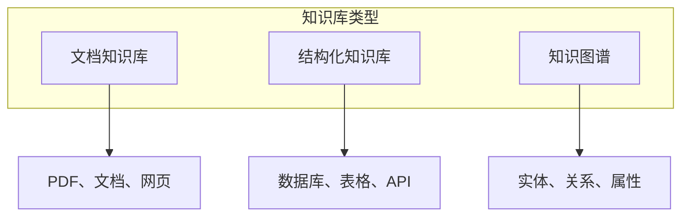
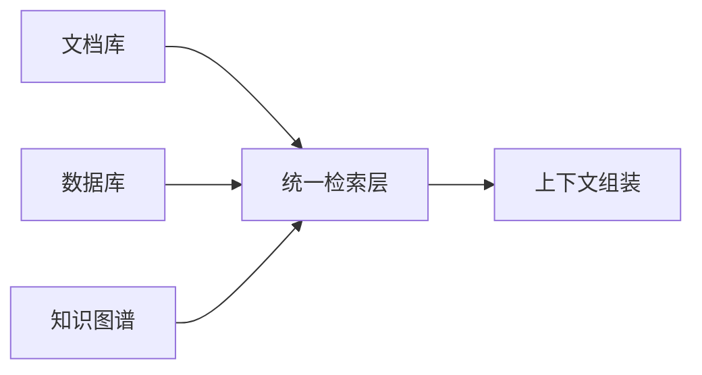

## 4.3 知识库构建与管理

### 4.3.1 知识库的定义与价值

**知识库** 是组织化的信息集合，专门用于为 AI 系统提供领域知识支持。与通用存储相比，知识库针对高效的知识检索和利用进行了专门的设计和优化。

知识库可以弥补模型的知识空白（提供训练数据中没有的信息），保证信息的时效性（包含最新的事实和数据），提供特定领域的专业知识，并通过经过验证的可靠来源确保信息的权威性。

### 4.3.2 知识库的类型

图 4-4：知识库类型

**文档知识库**存储非结构化文档内容，是最常见的知识库形式。其内容包括产品文档、技术手册、FAQ、博客文章，处理流程为文档解析 → 分块 → 向量化 → 索引，检索时基于语义相似度召回相关片段。

**结构化知识库**存储结构化数据，支持精确查询。其内容包括产品数据库、用户信息、配置数据，处理流程为数据建模 → Schema 设计 → 索引优化，检索时使用 SQL 查询或结构化 API。

**知识图谱**存储实体及其关系，支持关系推理。其内容是实体、属性、关系的三元组，处理流程为实体提取 → 关系抽取 → 图构建，检索方式为图遍历和路径查询。

### 4.3.3 知识库构建流程

#### 阶段一：数据收集

收集构建知识库的原始数据：
- 内部文档：产品文档、技术规范、内部知识库
- 外部资源：公开文档、API 文档、行业标准
- 生成内容：FAQ 整理、知识提炼

收集时应确保数据来源可靠、版权和使用授权清晰，并记录数据来源和更新时间。

#### 阶段二：数据处理

这一阶段将原始数据转换为可用格式。

**文档解析**包括 PDF 提取（表格、图片、文本）、网页清洗（移除广告和导航）和格式标准化（统一为 Markdown 或纯文本）。

**文本分块**（Text Chunking）的策略直接决定检索的粒度和质量（详见 [5.2 文档分块策略](../05_select/5.2_chunking.md)）。常用的三种分块策略包括：

1.  **固定大小分块 (Fixed-size Chunking)**：设定固定的 Token 数量切分，简单快速但可能破坏语义。
2.  **递归字符分块 (Recursive Character Chunking)**：使用一组分隔符按优先级递归切分，较好保持段落和句子完整性，是大多数场景的首选。
3.  **语义分块 (Semantic Chunking)**：利用嵌入模型计算语义相似度进行话题转换切分，精度高但计算成本大。

**元数据标注**为内容添加来源标记、时间戳、分类标签和重要性权重。

#### 阶段三：向量化与索引

这一阶段将处理后的内容转换为可检索形式。**嵌入生成**需要选择合适的嵌入模型，通过批量处理提高效率，并考虑多语言支持。**索引构建**可采用向量索引（HNSW、IVF 等算法）、支持关键词检索的倒排索引，或结合多种方法的混合索引。

#### 阶段四：质量验证

质量验证包括三类测试：
- 检索测试：验证典型查询的检索效果
- 覆盖测试：确认关键知识都被包含
- 准确性测试：抽样验证内容正确性

### 4.3.4 知识库维护

知识库需要持续维护：

| 维护任务 | 频率 | 目的 |
|----------|------|------|
| 内容更新 | 按需/定期 | 保持信息时效性 |
| 索引重建 | 定期 | 优化检索性能 |
| 质量审核 | 定期 | 发现和修复问题 |
| 反馈整合 | 持续 | 基于使用改进 |

### 4.3.5 多源知识整合

实际系统通常需要整合多个知识源：

图 4-5：多源知识整合

整合的难点在于：不同来源的内容格式不同，来源之间可能有冲突，信息的一致性难以维护。相应的策略是建立统一的检索接口，定义清晰的优先级规则，并实现冲突检测和处理机制。

### 4.3.6 知识库最佳实践

1. **从核心开始**：先覆盖最常用、最重要的知识。不要试图一开始就构建包罗万象的知识库，应识别用户最频繁查询的问题和场景，优先保证这些核心内容的质量和覆盖度。核心知识往往只占全部内容的一小部分，却能覆盖大部分高频查询。
2. **质量优先**：高质量的小知识库胜过低质量的大知识库。每一条进入知识库的内容都应经过审核，检查信息是否准确、表述是否清晰、是否有歧义。低质量内容无助于回答问题，还会降低整个系统的可信度，导致模型生成错误或矛盾的回答。
3. **持续迭代**：基于实际使用反馈不断改进。收集用户的查询日志，分析哪些问题检索失败或答案不满意，针对性地补充和优化内容。
4. **版本管理**：与代码库一样，知识库也需要版本控制，以便追踪内容变更、回滚错误更新、对比不同版本的效果。对于企业知识库，版本管理还有助于合规审计和问题追溯。
5. **监控使用**：跟踪知识库的使用情况和效果，建立检索成功率、用户满意度、知识覆盖度等关键指标，定期分析以发现知识空白和质量问题。
