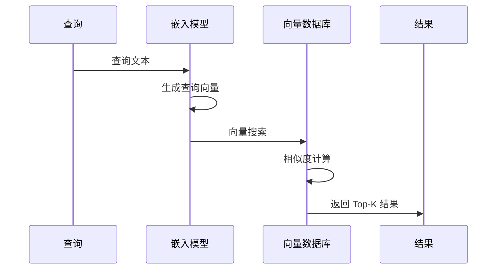

## 5.3 嵌入模型与语义搜索

### 5.3.1 嵌入的基本概念

**嵌入**（Embedding）是将文本转换为数值向量的过程。语义相近的文本在向量空间中距离也相近，这是语义搜索的数学基础。

嵌入模型的任务是将任意长度的文本映射到固定维度的向量空间，并保持语义相似性。

### 5.3.2 嵌入模型的工作原理

图 5-4：嵌入模型工作原理

主要步骤：
1. **分词**：将文本切分为 Token
2. **编码**：通过 Transformer 编码器获取上下文表示
3. **池化**：将多个 Token 表示合并为单一向量
4. **归一化**：可选，将向量归一化为单位长度

### 5.3.3 嵌入模型类型对比（示意）

嵌入模型与参数迭代很快，下面按“类型”给出对比视角，便于做选型决策（具体模型名、维度与最大长度以各厂商/开源项目文档为准）。

| 类型 | 维度（常见量级） | 最大长度（常见量级） | 特点 |
|------|------------------|----------------------|------|
| 商用通用嵌入模型 | 千级 | 千到万级 Token | 综合表现稳定，生态与工具链成熟 |
| 商用高精度嵌入模型 | 更高维度 | 千到万级 Token | 更高质量，成本与延迟更高 |
| 可裁剪维度嵌入模型 | 千级，可按维度截断 | 千到万级 Token | 通过 Matryoshka 表示学习或类似训练，让同一向量支持不同存储成本 |
| 多向量/晚交互检索模型 | 每个 Token 或片段多向量 | 依实现而定 | ColBERT 类 late interaction 保留细粒度匹配，召回质量高但索引和计算更重 |
| 开源中文/多语言嵌入模型 | 千级 | 百到千级 Token（不等） | 便于本地部署与可控性，需自建评测 |
| 指令式/任务特化嵌入模型 | 千级 | 百到千级 Token（不等） | 在特定检索范式（如 query/doc 前缀）下更稳健 |

### 5.3.4 嵌入模型选择因素

选择嵌入模型时需要考虑四个因素：

- **质量需求**：高质量场景选择能力更强的模型，一般场景使用平衡型模型可能已经足够。
- **语言支持**：纯中文场景中 BGE 系列表现突出；多语言场景可选 BGE-M3、Cohere、Voyage、Gemini 等。
- **上下文长度**：长文档检索需要支持更长输入的模型，短查询则大多数模型都能胜任；长上下文嵌入可结合 late chunking，先编码较长文档再对片段池化，减少切块前丢失的上下文。
- **成本与性能**：云服务按调用计费，需要考虑成本；本地部署需要考虑硬件资源。维度裁剪方面，OpenAI 与 Gemini 等模型支持或采用 Matryoshka 式维度控制，可在召回质量、存储和延迟之间做实测权衡。

### 5.3.5 语义搜索实现

**相似度度量**的常用方法如下：

| 方法 | 公式 | 特点 |
|------|------|------|
| 余弦相似度 | $\cos(\mathbf{A}, \mathbf{B})$ | 最常用，忽略向量长度 |
| 点积 | A · B | 快速计算 |
| 欧氏距离 | \|\|A - B\|\| | 考虑绝对位置 |

**检索流程**

图 5-5：语义搜索流程

### 5.3.6 嵌入质量优化

**查询增强**通过改造查询提高检索效果，方法包括：
- 查询扩展：添加同义词或相关术语
- 查询改写：使用 LLM 改写为更好的搜索形式
- 假设文档：生成假设的理想答案，用于检索

**文档增强**从文档侧优化嵌入，方法包括：
- 添加标题前缀：将标题拼接到内容前
- 摘要增强：为每个块生成摘要，用摘要嵌入
- 多向量表示：同一内容生成多个嵌入
- late chunking：对长文档先编码、后按块池化，适合指代关系和跨段上下文较强的材料
- late interaction：保存查询和文档的细粒度 Token 表示，在检索或重排阶段计算更细的相似度

### 5.3.7 嵌入的局限与对策

嵌入存在三类局限，各有对策：

- **语义鸿沟**：嵌入基于字面语义，可能忽略领域特定含义。对策是使用领域微调的嵌入模型，或结合关键词搜索。
- **跨语言差异**：不同语言的嵌入质量可能不一致。对策是选择多语言优化的模型，或翻译后检索。
- **长尾查询**：罕见表达的嵌入效果可能较差。对策是查询扩展，或结合多种检索方式。

### 5.3.8 嵌入模型更新

嵌入模型更新时，需要重新生成全部文档嵌入，保持查询与文档使用相同的模型，并考虑过渡期的兼容性。
