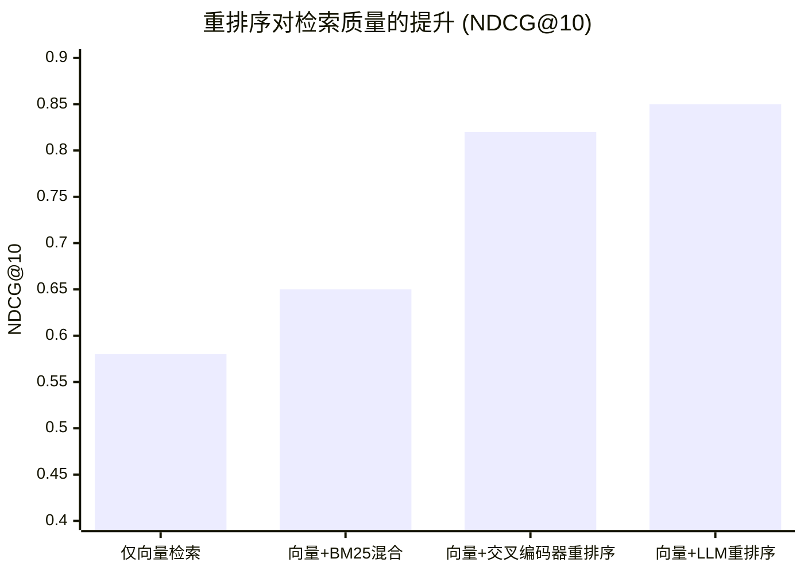

## 5.4 重排序与相关性优化

### 5.4.1 为什么需要重排序

向量检索虽然高效，但存在三点局限：嵌入是预计算的，无法考虑查询特定的语义；向量相似不等于真正的相关性；检索时只考虑局部匹配，缺乏全局视角。

**重排序**（Reranking）是对初步检索结果进行二次排序的技术，能够显著提升最终结果的相关性。

### 5.4.2 两阶段检索架构


图 5-6：两阶段检索架构

第一阶段快速召回大量候选（如 Top-100），第二阶段精细排序，选出最相关结果（如 Top-5）。这种架构兼顾了效率和精度。

### 5.4.3 重排序技术

#### 交叉编码器

交叉编码器将查询和文档拼接后输入模型，直接输出相关性得分。

```text
输入：[CLS] 查询 [SEP] 文档 [SEP]
输出：相关性分数 (0-1)
```

其优点是精度最高，能够捕捉查询-文档交互；缺点是计算成本高，无法预计算。常用模型有 BGE-Reranker、Cohere Rerank 和 ms-marco 系列。

#### 大语言模型重排序

大语言模型重排序使用语言模型判断相关性或排序，有两种方式。

方式一：逐对比较
```text
"以下两段内容哪个与查询更相关？
查询：...
内容A：...
内容B：..."
```

方式二：直接评分
```text
"评估以下内容与查询的相关性（1-10分）：
查询：...
内容：..."
```

这种方法灵活，可使用任何 LLM，但成本高、延迟大。

### 5.4.4 重排序性能对比实验（示意）

引入重排序步骤通常会增加延迟，但往往能提升检索质量（如 NDCG@10）。下面给出一个 **示意性的对比图**（不同数据集、候选集规模、模型与标注口径会导致结果差异很大）：



图 5-7：重排序对检索质量的提升示意

交叉编码器类重排序通常能带来明显的边际收益；LLM 重排序可能进一步提升效果，但往往伴随着更高的延迟与成本。

### 5.4.5 混合打分

结合多个信号进行打分：

```text
最终分数 = α × 语义分数 + β × 重排序分数 + γ × 其他信号
```

其他信号还可以包括关键词匹配得分、文档权威性、时间新鲜度和用户行为数据。

### 5.4.6 重排序实践

**召回候选数量**太少可能遗漏相关结果，太多则增加重排序成本，通常召回 20-100 条供重排序。

**重排序结果数量**根据后续使用确定：问答场景通常取 3-5 条，综合分析可能需要 10+ 条。

**性能优化**的手段包括批量处理以减少调用次数、使用轻量级重排序模型，以及缓存频繁查询的结果。

### 5.4.7 相关性优化的其他技术

**查询优化**在检索前改进查询，包括语义扩展（添加同义词）、意图识别（理解查询的真实意图）和子查询分解（拆分复杂查询）。

**结果多样化**避免返回重复或相似的结果，常用方法有 MMR（最大边际相关性）和聚类去重。

**反馈学习**利用点击数据、满意度评分和 A/B 测试结果等用户反馈改进排序。

### 5.4.8 重排序效果评估

常用评估指标：

| 指标 | 含义 |
|------|------|
| MRR | 平均倒数排名，关注第一个相关结果位置 |
| NDCG | 归一化折扣累积增益，考虑排名位置 |
| Recall@K | Top-K 结果中的召回率 |
| Precision@K | Top-K 结果中的精确率 |

实践中应选择与业务目标相关的指标进行优化。
