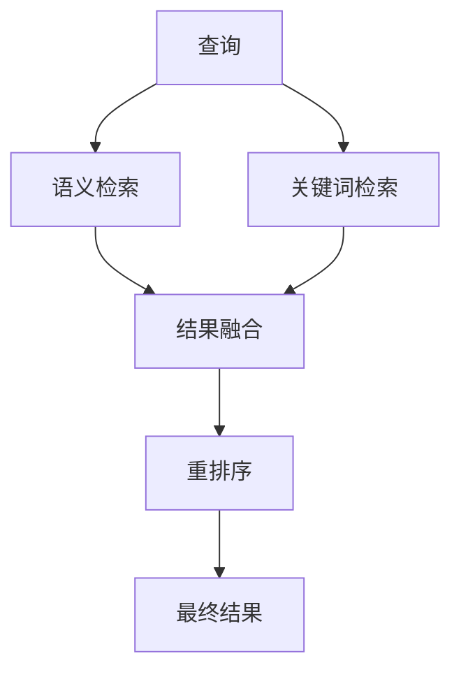

## 5.5 混合检索与高级检索增强生成

### 5.5.1 混合检索

**混合检索**（Hybrid Search）结合多种检索方法的优势，是当前 [RAG](5.1_rag_principles.md) 实践的标准配置。

#### 语义检索与关键词检索对比

| 特性 | 语义检索 | 关键词检索 |
|------|----------|------------|
| 优势 | 理解语义、处理同义词 | 精确匹配、高速 |
| 劣势 | 可能忽略关键词 | 无法处理语义 |
| 典型场景 | 开放式问题 | 专有名词、代码 |

#### 混合检索实现



图 5-8：混合检索流程

**分数融合策略**：

**简单加权**
```text
融合分数 = α × 语义分数 + (1-α) × 关键词分数
```

**倒数排名融合（RRF）**
```text
RRF(d) = Σ 1/(k + rank_i(d))
```

RRF 不依赖原始分数，只使用排名，更加鲁棒。

### 5.5.2 高级检索增强生成技术

#### 查询转换

查询转换在检索前对查询进行增强。**查询扩展**通过同义词扩展、添加相关术语和多语言翻译扩大查询的覆盖范围。**查询分解**将复杂查询拆分为子查询：

```text
原始查询：比较 A 产品和 B 产品在性能和价格方面的差异
分解为：
- A 产品的性能
- B 产品的性能
- A 产品的价格
- B 产品的价格
```

**假设文档生成**（HyDE）先生成假设的答案，再用其嵌入进行检索：

1. 让 LLM 生成假设答案
2. 将假设答案转换为嵌入
3. 用假设答案的嵌入检索

#### 多跳检索

对于需要多步推理的问题，可以迭代检索：


图 5-9：多跳检索流程

多跳检索适用于需要背景知识支持或涉及多个实体关系的问题。

#### 自适应检索

自适应检索根据查询特点动态调整策略。**路由机制**根据查询类型选择不同的检索路径：
- 事实查询 → 精确检索
- 概念查询 → 语义检索
- 对比查询 → 多路检索

**无需检索的识别**是指判断哪些查询不需要检索：常识问题依靠模型本身的知识即可，创意任务不需要外部事实。

#### 上下文增强

上下文增强用于丰富检索结果的上下文。**父子块策略**使用小块检索以保证精度（precision），返回大块内容以保留上下文（context）：

```text
小块（检索用）: 约 200 Token
大块（返回用）: 约 1000 Token
```

**滑动窗口扩展**在检索到某块后自动包含相邻块。**元数据增强**将来源、章节等元数据附加到结果中。

### 5.5.3 检索增强生成评估框架

#### 组件级评估

分别评估 RAG 各组件：

| 组件 | 评估指标 |
|------|----------|
| 检索 | Recall、MRR、NDCG |
| 生成 | 准确性、完整性、一致性 |
| 端到端 | 用户满意度、任务成功率 |

#### 常用评估工具

- **RAGAS**：自动化 RAG 评估框架
- **TruLens**：RAG 质量监控
- **人工评估**：复杂场景仍需人工判断

### 5.5.4 检索增强生成调优策略

**问题诊断**的常见问题及对策如下：
- 检索不到相关内容 → 优化分块/嵌入
- 检索质量低 → 添加重排序
- 生成答案错误 → 优化提示词，加入约束

**迭代优化**

1. 收集失败案例
2. 分析失败原因
3. 针对性优化
4. 验证效果
5. 持续监控
