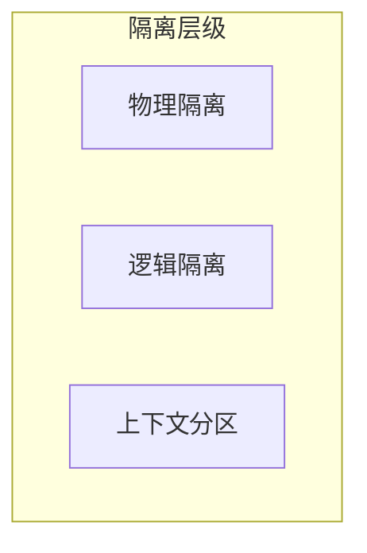
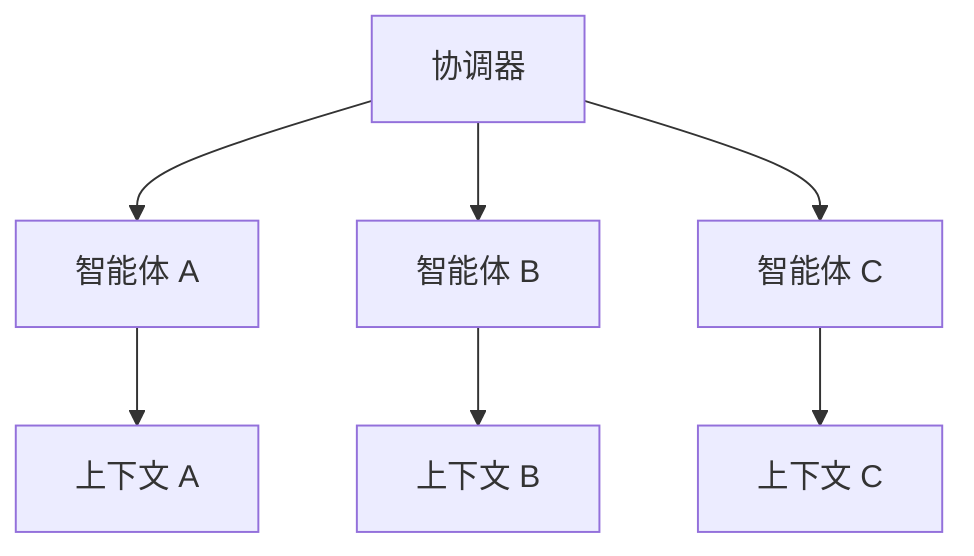

## 7.4 多任务上下文隔离

### 7.4.1 多任务场景的挑战

复杂系统常常需要在同一交互中处理多个任务或子任务，由此带来三个挑战：

- 任务混淆：不同任务的上下文相互干扰
- 优先级冲突：不同任务可能有矛盾的要求
- 状态管理：需要追踪多个任务的进展

### 7.4.2 任务隔离的必要性

任务隔离确保：
- 每个任务有独立的上下文环境
- 任务之间的干扰最小化
- 便于独立调试和优化

### 7.4.3 隔离策略



图 7-5：隔离层级

#### 物理隔离

完全独立的调用，每个任务单独处理：

```text
任务 A → 独立 API 调用 → 结果 A
任务 B → 独立 API 调用 → 结果 B
任务 C → 独立 API 调用 → 结果 C
```

物理隔离完全隔离、无干扰，但无法共享上下文，成本可能更高，适用于任务完全独立、对隔离要求极高或可并行执行的场景。

#### 逻辑隔离

在同一调用中使用结构隔离不同任务：

```xml
<task_1>
<description>分析销售数据</description>
<context>销售表格数据...</context>
<requirements>输出增长趋势</requirements>
</task_1>

<task_2>
<description>生成营销建议</description>
<context>竞品分析报告...</context>
<requirements>输出 3 条建议</requirements>
</task_2>
```

逻辑隔离可共享部分上下文，效率较高，但任务之间仍可能相互影响，适用于任务有共享背景、需要统一协调或输出有关联性的场景。

#### 上下文分区

将上下文划分为不同区域，按需暴露给不同任务：

```text
共享区域：通用规则、基础知识
任务 A 区域：A 专属数据和指令
任务 B 区域：B 专属数据和指令
```

### 7.4.4 多智能体场景的隔离

在多智能体系统中，任务隔离更为重要：



图 7-6：多智能体隔离架构

设计要点：
- 每个智能体有独立的上下文
- 协调器管理信息在智能体间的流动
- 避免“上下文膨胀”，不传递不必要的信息

### 7.4.5 上下文传递控制

在任务或智能体之间传递信息时需要控制：

**最小信息原则**

只传递必要的信息，避免冗余：

```text
从任务 A 传递到任务 B：
❌ 完整对话历史
✓ 任务 A 的结论摘要
```

**显式接口**

定义清晰的信息传递接口：

任务输出格式：

```jsonc
{
  "conclusion": "...",
  "key_facts": [...],
  "next_task_hints": [...]
}
```

**过滤机制**

根据下游任务需求过滤信息：

```python
if downstream_task == "summarize":
    pass_context = extract_key_points(full_context)
elif downstream_task == "analyze":
    pass_context = full_context
```

### 7.4.6 隔离的实现模式

#### 会话分离

不同任务使用不同会话 ID：

```text
任务 A → session_id: "task_a_001"
任务 B → session_id: "task_b_001"
```

#### 命名空间

在同一上下文中使用命名空间隔离：

```xml
<namespace name="task_a">
  <!-- 任务 A 专属内容 -->
</namespace>

<namespace name="task_b">
  <!-- 任务 B 专属内容 -->
</namespace>
```

#### 作用域控制

明确指定指令的作用范围：

```text
以下规则仅适用于分析任务：
- ...

以下规则仅适用于生成任务：
- ...
```

### 7.4.7 最佳实践

**1. 默认隔离**

默认采用隔离设计，按需共享。宁可多隔离也不要过度共享。共享上下文一旦出现问题，排查和修复都很困难。从完全隔离开始，只在确认需要时才开放共享，并记录共享的原因和范围。

**2. 清晰边界**

明确定义任务边界和接口。每个任务应该有明确的输入要求、输出格式和职责范围。模糊的边界会导致任务蔓延、上下文膨胀。用文档或 Schema 定义接口，确保团队成员理解一致。

**3. 最小共享**

只共享确实需要的上下文。对每一项共享内容，都要评估下游任务是否确实需要、能否用更精简的形式传递。不必要的共享既增加 Token 消耗，也增加上下文污染的风险。

**4. 显式传递**

信息传递应当显式且可控：明确指定传递什么、传递给谁，不依赖隐式的上下文继承。这样便于追踪信息流向，也便于在出问题时定位原因。每次传递的内容和时间都应记录。

**5. 独立测试**

每个隔离单元都应能独立测试。设计时就要考虑可测试性，使每个任务或智能体能够单独测试其输入输出行为，并用 mock 数据模拟上下游。这样既加速开发迭代，也便于排查集成后的问题。

### 7.4.8 实践案例：子智能体上下文隔离（示意）

一些生产级智能体系统常见的做法是将职责分解为专门的子智能体（如 Planner、Executor、Knowledge Manager 等），以实现大规模任务的上下文隔离。

（关于相关架构思路的进一步讨论，请参见 [13.5 案例分析：全自主智能体架构（示意）](../13_cases/13.5_generalist_agent.md)）
