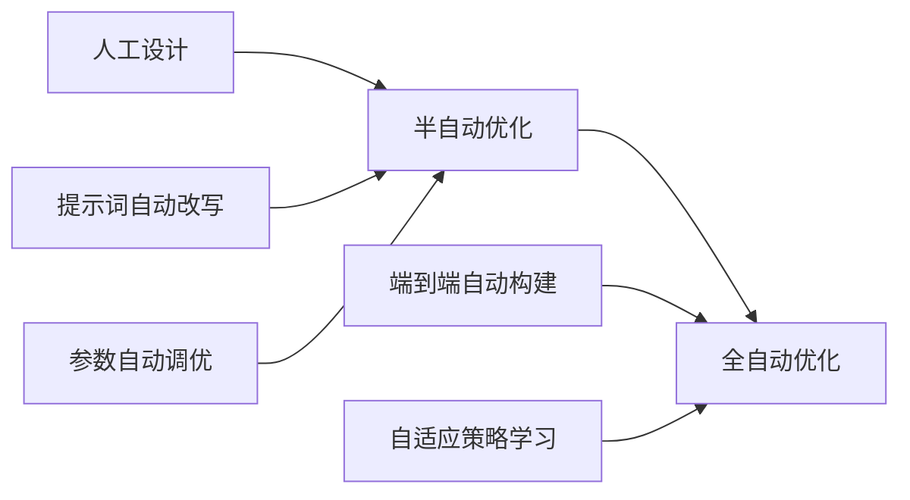

## 15.3 挑战与机遇

上下文工程是一个快速发展的领域，面临诸多挑战，也蕴含巨大机遇。理解这两方面有助于把握行业发展方向。

### 15.3.1 当前挑战

#### 技术挑战

**评估困难**

如何客观评估上下文质量仍是一个开放性难题：

| 挑战 | 具体表现 | 当前应对 |
|------|----------|----------|
| 缺乏统一标准 | 不同任务的评估指标不统一 | 建立任务特定的评估体系 |
| 间接评估的局限 | 上下文质量只能通过下游效果间接评估 | 结合多维度指标综合判断 |
| 评估成本高 | 人工评估耗时，自动评估不够准确 | LLM 辅助评估 + 人工抽检 |
| 主观性强 | “好的上下文”定义因场景而异 | 建立场景化的评估基准 |

**动态优化**

在运行时动态调整上下文策略面临四方面困难：实时决策复杂，需要快速判断最优策略；效果预测存在不确定性，无法准确预测调整效果；优化本身也有代价，需要平衡成本与效果；还要权衡探索与利用（尝试新策略 vs 使用已知有效策略）。

**可解释性**

理解上下文如何影响模型输出同样困难。在归因上，无法精确知道输出受哪部分上下文影响；在调试上，问题定位困难；在透明度上，某些场景（如医疗、法律）需要解释决策依据；在可追溯性上，需要追踪答案来源。

**跨模态上下文**

随着多模态模型的发展，需要解决如何统一管理文本、图像、音频、视频上下文，如何有效表示和检索不同模态的内容，以及如何判断跨模态的相关性。

#### 工程挑战

**复杂性管理**

大规模系统的上下文管理复杂度高，涉及检索、压缩、缓存等模块的协作，提示词、策略、参数的版本控制，难以覆盖所有边界情况的测试，以及分布式系统的问题定位。

**成本控制**

系统需要在效果和成本之间找到平衡：Token 成本随使用量增加而持续增长，嵌入计算、向量检索需要计算资源，上下文优化的投入产出（ROI）也难以精确量化。

**规模化**

从 PoC 到大规模生产之间存在鸿沟：性能在高并发下退化，知识库规模增长带来检索性能问题，多租户架构也更加复杂。

#### 组织挑战

**专业人才稀缺**

上下文工程人才相对稀缺。这一领域要求跨领域技能，需要同时理解 LLM、检索和工程；实践经验尤为重要，而经验积累需要时间；培训体系不完善，缺乏系统化的培养路径；技术快速变化，持续学习的压力大。

**组织协作**

跨团队协作的复杂性体现在 AI 团队与业务团队的沟通、知识库维护的责任归属，以及效果评估标准的对齐。

### 15.3.2 未来机遇

#### 技术机遇

**自动化优化**

AI 辅助的上下文工程自动化：

图 15-1：自动化优化发展路径

具体方向：
- 自动提示词优化：DSPy 等框架的发展
- 智能分块策略：根据内容自动选择
- 自适应检索：根据查询动态调整策略
- 上下文自动编码：ICAE 等压缩技术

**标准化红利**

标准化带来效率提升：标准化的模块可跨项目复用，标准化促进工具生态发展，最佳实践得以传播和复用，不同系统间的集成也更容易。

**模型能力提升**

模型能力持续增强也带来机遇：更长的上下文窗口将改变信息管理方式，更好的指令遵循让上下文设计更简单，多模态能力支持统一的跨模态上下文管理，推理能力增强则支持更复杂的上下文利用。

#### 商业机遇

**差异化竞争力**

上下文工程能力正在成为核心竞争优势：记忆和个性化带来更好的用户体验，精准的知识检索带来更高的准确性，优化的上下文策略降低成本，系统化的评估和优化加快迭代。

**新产品形态**

基于上下文工程的创新产品：
- 具有真正记忆的个人助手
- 领域专家级别的 AI 系统
- 智能协作工作平台
- 知识管理和增强系统

**服务化机会**

上下文工程服务的市场空间：
- 知识库构建和维护服务
- 上下文系统咨询和优化
- 评估和监控平台
- 行业解决方案

#### 职业机遇

上下文工程师将成为重要的新兴职业：

| 机遇维度 | 具体表现 |
|----------|----------|
| 需求增长 | 企业 AI 应用的普及推动需求 |
| 跨行业适用 | 各行业都需要上下文工程能力 |
| 高价值定位 | 影响 AI 应用的核心效果 |
| 发展空间 | 从工程师到架构师到 AI 技术负责人 |

### 15.3.3 应对策略

应对挑战、把握机遇的建议如下：

1. **投资技术深度**：深入理解原理，而非只停留在工具使用层面
2. **关注评估能力**：建立系统化的评估体系
3. **保持学习敏锐**：紧跟领域发展，拥抱新技术
4. **积累领域知识**：结合具体行业场景积累经验
5. **构建可复用能力**：形成自己的方法论和工具库
