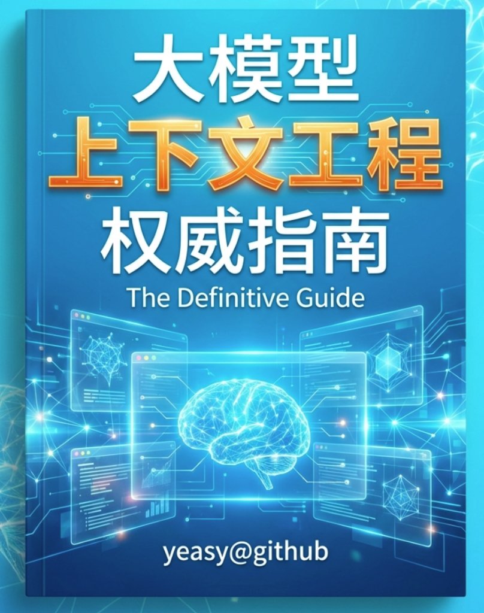

# 大模型上下文工程权威指南

学习如何为大模型组织上下文，覆盖检索、记忆、工具调用、评估和生产治理。

**[在 GitBook 阅读第一章 · 上下文工程概述](https://yeasy.gitbook.io/context_engineering_guide/di-yi-bu-fen-ren-shi-shang-xia-wen-gong-cheng/01_overview)**

[全书目录（GitHub）](https://github.com/yeasy/context_engineering_guide/blob/main/SUMMARY.md) · [正式 PDF（发布页）](https://github.com/yeasy/context_engineering_guide/releases/latest)



## 为什么需要这本书？

提示词工程是上下文工程的基础子集：前者负责单次交互中的指令、格式和示例设计，后者进一步管理模型推理时看到的完整信息环境。

当 LLM 应用从实验走向生产，**单纯的提示词设计已不足以构建可靠的 AI 系统**。

> 如何在正确的时间，将正确的信息，以正确的格式，提供给模型？

本书围绕这一问题，系统讲解上下文的写入、选择、压缩、隔离及其生产治理。

<details>

<summary>本书与提示词、RAG 和智能体资料的关系</summary>

| 资料类型 | 关注对象 | 本书补充 |
|---------|---------|---------|
| 提示词工程 | 单次交互中的指令、格式与示例 | 将提示词与检索、记忆、权限、预算和多轮状态纳入同一生命周期 |
| RAG 资料 | 文档检索与答案生成 | 把检索与工具、记忆、对话历史、可观测性及事故处理结合起来 |
| 智能体资料 | 规划、工具调用和多步任务 | 处理上下文污染、压缩、来源追踪与状态隔离 |
| 平台和框架文档 | API、参数、SDK 和组件用法 | 提供跨平台的工程方法、取舍依据与评审清单 |

</details>

## 从哪里开始

- **想从提示词进阶到上下文工程** · 从[第一章](https://yeasy.gitbook.io/context_engineering_guide/di-yi-bu-fen-ren-shi-shang-xia-wen-gong-cheng/01_overview)开始，再读[四大核心策略](https://yeasy.gitbook.io/context_engineering_guide/di-yi-bu-fen-ren-shi-shang-xia-wen-gong-cheng/03_framework/3.2_four_strategies)，用写入、选择、压缩和隔离梳理一个现有的多轮对话。
- **想动手做知识库问答** · 先读[上下文选择与检索](https://yeasy.gitbook.io/context_engineering_guide/di-er-bu-fen-he-xin-ji-shu-yu-ce-le/05_select)，再运行 [EnterpriseKnow 最小实验](https://github.com/yeasy/context_engineering_guide/tree/main/examples/enterprise_know)，对照不同部门的查询结果，检查权限过滤与来源引用。
- **想管理智能体的记忆和状态** · 从[智能体上下文管理](https://yeasy.gitbook.io/context_engineering_guide/di-san-bu-fen-jin-jie-ji-shu-yu-jia-gou/09_agents)开始，明确哪些状态应保留、哪些状态可在智能体之间传递。长任务可继续读 [Context→Harness→External Loop](10_advanced/10.9_context_harness_external_loop.md)。
- **已有应用，需要上线或排查故障** · 从[生产环境最佳实践](https://yeasy.gitbook.io/context_engineering_guide/di-si-bu-fen-gong-cheng-shi-zhan-yu-wei-lai-yan-jin/12_production)开始，用[上下文架构评审卡](15_future/15.4_becoming_expert.md)检查信息来源、权限、预算、失败模式和回归评估。

<details>

<summary>按角色选读与前置知识</summary>

| 读者角色 | 阅读顺序 | 学习重点 |
|---------|---------|---------|
| AI 应用开发者 | 第 1–3 章 → 第 4–9 章 → 第 12–14 章 | 检索、记忆、工具调用、智能体和生产部署 |
| 提示词工程师 | 第 1–3 章 → 第 4–8 章 → 第 11–12 章 | 上下文生命周期、反模式与治理 |
| AI 产品经理 | 第 1–3 章 → 第 12–13 章 → 第 15 章 | 产品价值、行业应用和未来趋势 |
| AI 架构师 | 全书精读，重点是第 8–10 章和第 12–14 章 | 性能、可观测性、权限和架构治理 |
| 研究人员 | 第 1–3 章 → 第 10 章 → 第 12 章 → 第 15 章 | 长上下文、多模态、评估与前沿方向 |

建议具备基础编程能力并了解大语言模型。代码路线需要能阅读 Python、HTTP API 和 JSON。生产路线需要了解日志、指标、权限、缓存和发布流程。研究路线需要能读论文摘要、评估指标和基准实验。

更多学习与实践建议见[第 1.4 节 本书结构与学习路径](01_overview/1.4_roadmap.md)。各章末尾的“本章小结”可用于复习。

</details>

## 全书结构

- **认识上下文工程（第 1–3 章）** · 从[第 1 章](https://yeasy.gitbook.io/context_engineering_guide/di-yi-bu-fen-ren-shi-shang-xia-wen-gong-cheng/01_overview)了解上下文工程，继而理解上下文窗口、设计原则和质量评估方法。
- **核心技术与策略（第 4–7 章）** · 从[第 4 章](04_write/README.md)的外部存储和记忆开始，接着学习分块、混合检索、重排序、摘要和上下文隔离。
- **进阶技术与架构（第 8–11 章）** · 从[第 8 章](08_tools/README.md)的工具调用与 MCP 开始，进而学习智能体、长上下文、多模态、Graph RAG 及常见失败。
- **工程实战与未来演进（第 12–15 章）** · 从[第 12 章](https://yeasy.gitbook.io/context_engineering_guide/di-si-bu-fen-gong-cheng-shi-zhan-yu-wei-lai-yan-jin/12_production)的成本、可观测性与治理开始，进一步阅读行业案例，动手实现企业知识库问答系统。
- **附录** · 查阅[术语表](appendix/glossary.md)、[工具与技术生态](appendix/tools.md)、[参考资源](appendix/resources.md)、[参考文献](appendix/references.md)与[快变事实核验表](appendix/volatile_facts.md)。

## 延伸阅读

- [大模型提示词工程指南](https://yeasy.gitbook.io/prompt_engineering_guide) · 练习单次交互的指令、格式和示例设计。
- [智能体 AI 权威指南](https://yeasy.gitbook.io/agentic_ai_guide) · 深入学习智能体架构与协作。
- [智能体 Harness 工程指南](https://yeasy.gitbook.io/harness_engineering_guide) · 了解记忆子系统与上下文组装的工程实现。

<details>

<summary>更多系列图书</summary>

- [零基础学 AI](https://yeasy.gitbook.io/ai_beginner_guide) · 补充人工智能的基础概念。
- [Claude 技术指南](https://yeasy.gitbook.io/claude_guide) · 学习 MCP 协议与工具使用。
- [大模型安全权威指南](https://yeasy.gitbook.io/ai_security_guide) · 查阅提示注入防御和 RAG 安全。
- [OpenClaw 从入门到精通](https://yeasy.gitbook.io/openclaw_guide) · 学习开源智能体框架中的上下文工程实践。
- [大模型原理与架构](https://yeasy.gitbook.io/llm_internals) · 深入理解大语言模型的原理与架构。

</details>

## 反馈与贡献

欢迎在 [GitHub Issues](https://github.com/yeasy/context_engineering_guide/issues) 报告勘误或提出建议，也可以[提交 Pull Request](https://github.com/yeasy/context_engineering_guide/pulls)。

<details>

<summary>本地开发与预览</summary>

在 macOS 上安装 [mdPress](https://github.com/yeasy/mdpress)，然后在仓库根目录启动本地预览。

```bash
brew tap yeasy/tap
brew install --cask mdpress
mdpress serve
```

启动后打开 [本地阅读地址](http://localhost:9000)。[默认分支 PDF 预览版](https://github.com/yeasy/context_engineering_guide/releases/download/preview-pdf/context_engineering_guide.pdf)随主线更新，正式版本以发布页为准。

维护[术语表](appendix/glossary.md)时，请按字母或拼音顺序排列术语，提供中英文对照和简明定义。

</details>

<details>

<summary>致谢</summary>

感谢为大模型技术发展做出贡献的研究者、工程师和开源社区。感谢 [Anthropic](https://www.anthropic.com/) 对上下文工程和 MCP 的贡献，[OpenAI](https://openai.com/)、[Google](https://ai.google/)、[Meta](https://ai.meta.com/) 对大语言模型的持续创新，以及 [LangChain](https://langchain.com/)、[LlamaIndex](https://llamaindex.ai/) 对 RAG 框架的贡献。

</details>

## 许可证

本书采用 [CC BY-NC-SA 4.0](https://creativecommons.org/licenses/by-nc-sa/4.0/) 许可证。

您可以自由分享和演绎，但需署名、非商业使用、相同方式共享。
